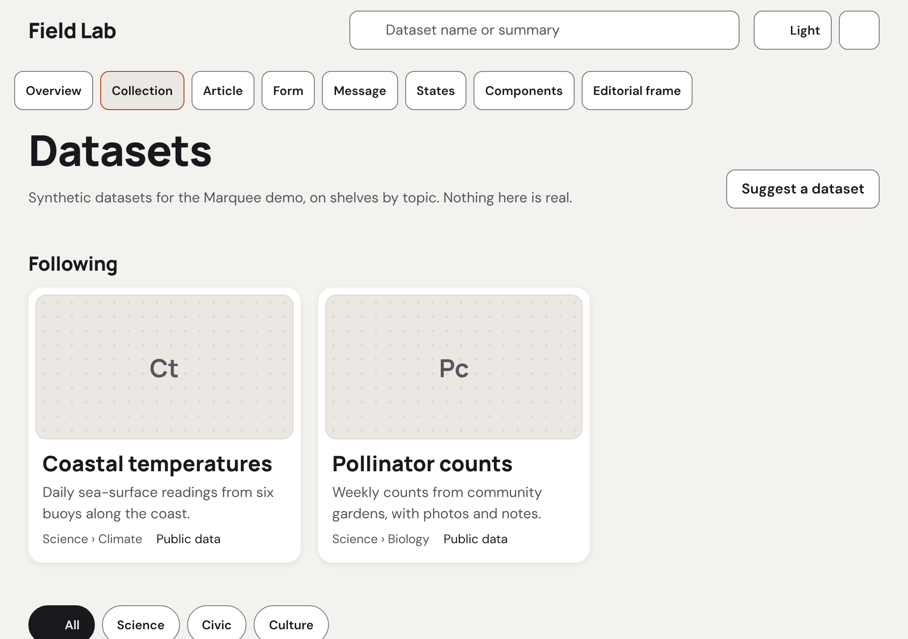
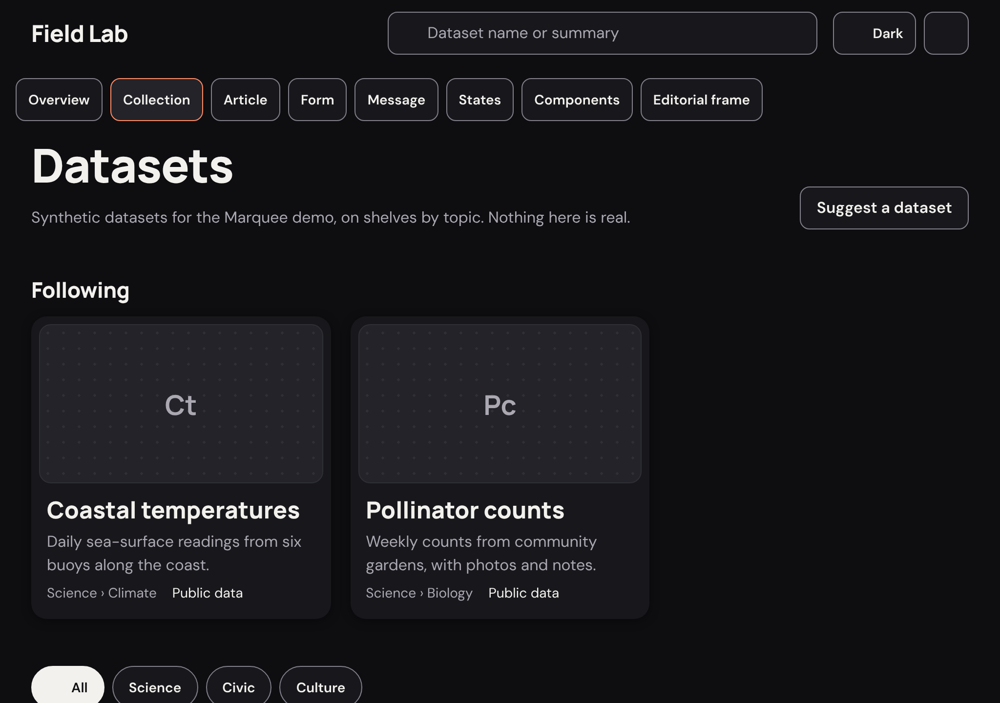
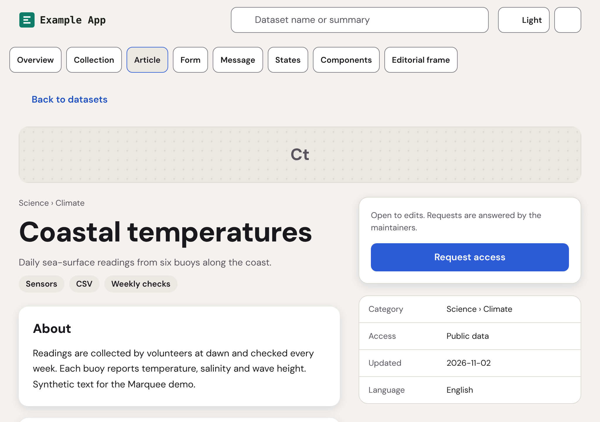

# wakolab-design-systems-marquee
Marquee: a bold, expressive design system with configurable light/dark colors, fonts and logos.

## Status

**Extraction integrated in `dev`** ([#1](https://github.com/WakoLab-DesignSystems/wakolab-design-systems-marquee/issues/1), `1660677`), not released; its human Docker acceptance is tracked on #1. The single HTML file is a **candidate** for [#6](https://github.com/WakoLab-DesignSystems/wakolab-design-systems-marquee/issues/6), under review.

- **What was extracted:** Marquee's components, styles, fonts and neutral compositions, from the WakoLab frontend at `e492bec`.
- **Mechanisms:** copied, with attribution, from the Folio design system at `0856c72` (itself copied from Console at `018fe32`), following the [standard](https://github.com/WakoLab-DesignSystems/wakolab-design-systems-standard) at `c2ca848`; the HTML file follows the integrated kit standard at `8e3b818`, the version this repository now declares, and copies its method from Folio at `a6b153f`. They are local copies; Marquee depends on neither repository. Provenance is in [docs/PROVENANCE.md](docs/PROVENANCE.md), parity evidence in [docs/PARITY.md](docs/PARITY.md), and a temporary Docker-only acceptance procedure in [docs/ACCEPTANCE.md](docs/ACCEPTANCE.md).
- **How to use it:** the package is `private`; use it from a clone or a Git dependency.

**The kit is not complete yet.**

| Kit element | State |
|---|---|
| Library, configuration contract, design rules, demo with a menu, checks | In this repository |
| Single offline HTML file (`marquee-kit.html`) | **Candidate** for [#6](https://github.com/WakoLab-DesignSystems/wakolab-design-systems-marquee/issues/6), under review: see [Try it without installing](#try-it-without-installing) |
| Docker start (maintained kit) | **Not delivered yet**: later batch. [docs/ACCEPTANCE.md](docs/ACCEPTANCE.md) is a temporary review procedure, not the kit |
| Figma companion (`.fig`) | **Not delivered yet**: after the standard's Figma spike |
| README screenshots | Light, dark and example configuration, below (taken from the HTML file) |
| Icon artwork | **Excluded**: see [Icons](#icons) |

## Try it without installing

One file, no installation, no network: [`marquee-kit.html`](marquee-kit.html) (about 7 MB) contains the whole demo, its scripts and styles, every default font, and the example configuration with its font and logos.

| Light | Dark | Example configuration |
|---|---|---|
|  |  |  |

**Download and open it**
1. Open [`marquee-kit.html`](marquee-kit.html) on GitHub and use **Download raw file** (GitHub shows the file's source, not the running page).
2. Double-click the downloaded file. It opens in your browser from your disk (`file://`) and works offline; it makes no network request.
3. Use the menu to visit the eight screens: overview, collection, article, form, message, states, components and the editorial frame. Switch light and dark with **Appearance** in the header. Everything works with the keyboard (Tab, Enter, arrow keys, Escape).

**Use your own configuration, logo and fonts** (on the *Overview* page, section *Configuration*)
1. Under *Your configuration*, choose a `design-config.json` with **Configuration file**. Its colours apply at once. To start from the example, download its files from the links in the same section, then edit them.
2. Choose the font and logo files that the configuration names with **Font and logo files**. A file is matched by its file name; a list shows which named files are selected and which are not yet.
3. Everything stays on your computer: the files are read in memory, nothing is uploaded.

**What a reload keeps.** Navigating between screens keeps everything. After a reload (or reopening a bookmarked address):
- the screen, the mode and your configuration's values come back, because they are written in the page address (`#…&config=local&local=…`);
- **the font and logo files must be selected again**: a browser does not keep access to files from your disk. Until you select them, a font role without its file keeps Marquee's default, and the logo shows the product name as text;
- the shipped defaults and the example configuration are always available, since they are inside the file.

**Which version is it?** The file names the commit it was built from in its first lines and on the *Overview* page (`marquee-kit-source`). [Rebuilding it](#the-html-file-is-generated) from that commit gives the same bytes. Its *Licences* section carries Marquee's MIT licence and every third-party licence.

## About Marquee

Marquee is a bold, visual discovery system:
- covers first: thematic **shelves of three tiles**, with the text under the cover (an image, or initials);
- a **bounded 21:9 banner** on detail pages (a short initials band without an image), chips and raised section cards;
- forms on a **raised card**, **large heavy headings**, search in the top bar;
- 56px rows, large radii (10/16px, 12px covers), **card shadows in light and dark mode**, and 180ms motion with a 3px **hover lift** that reduced motion keeps still.

Default fonts are DM Sans for the interface and **Manrope 800** for display, with Noto Sans SC and Noto Sans Devanagari as fallbacks, each under its own licence. Design rules are in [docs/rules/](docs/rules/README.md).

## Independent use

This repository is **self-contained**: it needs no other WakoLab or WakoLab-DesignSystems repository, submodule or sibling checkout. It requires Node.js 24 or later, and React and React DOM 19.2.0 in the consuming app.

**Clone and build:**

```bash
git clone https://github.com/WakoLab-DesignSystems/wakolab-design-systems-marquee.git
```

```bash
cd wakolab-design-systems-marquee && npm ci
```

`npm ci` builds `dist/` through `prepare`; `npm pack` then makes a tarball an app can install.

**Or use a Git dependency** (`prepare` builds it; pin a commit):

```json
"wakolab-design-systems-marquee": "git+https://github.com/WakoLab-DesignSystems/wakolab-design-systems-marquee.git#<commit>"
```

## Usage

```tsx
import "wakolab-design-systems-marquee/marquee.css";
import { MarqueeRoot, MarqueeShell, MarqueeHeader, LogoSlot, Page, Button } from "wakolab-design-systems-marquee";

export function App({ config }) {
  return (
    <MarqueeRoot config={config} assetBase="/design/" defaultMode="system">
      <MarqueeShell header={<MarqueeHeader logo={<LogoSlot label="My App" />} />}>
        <Page><h1>Library</h1><Button>Add a title</Button></Page>
      </MarqueeShell>
    </MarqueeRoot>
  );
}
```

**The root.** Everything renders inside `MarqueeRoot`, which outputs `<div data-wds="marquee" data-mode="light|dark">`.
- The stylesheet is prebuilt and scoped to that root: it styles nothing outside it, including `html` and `body`.
- Its cascade layers, keyframes, registered properties and font families carry the `wds-marquee-` prefix.
- Several roots can coexist on one page.

**`MarqueeRoot` props:**
- `mode` (controlled) or `defaultMode`;
- `onModeChange`;
- `storageKey` (nothing is stored without it);
- `config`, `assetBase`, `icons`, `onDiagnostic`;
- `className`, `style`, `id`.

**Exports:**
- **Components:** Button, IconButton, the fields, SearchField, ToggleChip, Popover, Dialog, ConfirmDialog, Tabs, Toast, Alert, Badge, Card, Stepper, ConnectionRow, EmptyState, Skeleton.
- **Parts:** FilterChips, Cover, ItemLink, CollectionStatus, LoadMore, KeyValueList, MessageBlock, BackLink, LoadingState, ProblemState, LogoSlot, ToolButton, ModeMenu.
- **Compositions:** MarqueeHeader (logo, search, tools), MarqueeShell, Page, CollectionLayout, HighlightSection, Shelf, TileGrid, TileContent, DetailLayout, CardSection, Panel, FormPage, MessagePage, RegistrationFrame, EditorialPanel.
- **Package files:** `marquee.css`, `config.default.json`, `config.schema.json`.

Marquee has no keyboard shortcuts layer; the source had none.

## Configuration

Pass a parsed `design-config.json` as `config` (see the [schema](config.schema.json), the [defaults](config.default.json), the [example](examples/config/design-config.json) and the [specification](https://github.com/WakoLab-DesignSystems/wakolab-design-systems-standard/blob/c2ca848d0b44c62a2864f1c23d99b7ec7d34bdc1/docs/CONFIGURATION.md)).

**How values are applied:**
- Every key except `system` and `systemVersion` is optional.
- Every value is used **exactly as written**; omitted keys keep Marquee's defaults.
- Marquee derives nothing and judges nothing. It only reports structural problems through `onDiagnostic`.

**Colours.** Set per mode (`light`, `dark`), by role:
- **Common roles:** `bg`, `surface`, `surface-2`, `ink`, `muted`, `border`, `control`, `action`, `action-hover`, `action-pressed`, `on-action`, `link`, `focus`, `accent`, `success`, `success-soft`, `warning`, `warning-soft`, `danger`, `danger-soft`, `info`, `info-soft`, `on-danger`, `scrim`, `shadow-card`, `shadow-pop`.
- Marquee declares **no system-specific roles**; other systems' roles (for example Folio's `panel`) are reported as unknown and ignored.
- **Omitted roles** keep their own same-mode defaults. The only exception is `action-pressed`, which follows the effective `action-hover`.
- **Independent roles:** `link` never follows `action`, and `focus` never follows `ink` (its default happens to equal `ink`'s).
- **Shadows** are roles: `shadow-card` (tiles, cards, panels, the form card) and `shadow-pop` (tile hover, overlays), set per mode with any CSS `box-shadow` value.
- **No effect in Marquee:** `accent`. It is accepted and applied to the root, but no Marquee element uses it (in the frontend source, only Console's classes do).

**Fonts.** Roles are `ui`, `display`, `prose` and `code`. Each needs a non-empty `family`, and optionally your own files (at least one when `files` is given: `src`, plus optional `weight`, `style`, `stretch`, `unicodeRange`).
- Files are registered under an internal family name, so your `family` label never collides with other fonts.
- Each role keeps its own default when omitted or removed.
- A file that fails to load, an empty `family` or an empty `files` list restores that role's default and is reported.
- `code` has no visible effect in Marquee.

**Logo.**
- Set `mark` and/or `wordmark` (one file, or one per mode), plus `alt`.
- Without logo files, the logo slot shows the label in the display face (Manrope 800).
- A logo file that fails to load is reported and treated as omitted.

**Paths.** Relative paths resolve against `assetBase`.

## Icons

Marquee ships **no icon artwork**. The provenance of the frontend's icon paths is unresolved (standard EXTRACTION_MATRIX §10, E4), so they were not copied, and the documentation and package are checked for it (`scripts/check-artwork.mjs`).

**Supplying icons:**
- Components keep their icon slots, under the names exported as `iconNames`.
- Supply your own set through `MarqueeRoot icons`: an object of name → SVG path data you are entitled to use, drawn for a 24×24 view box. Keep it in your own project.
- A name without a path renders an empty box of the same size, marked `data-icon-missing`; nothing is substituted.

## Demo

```bash
npm run build && npm run example
```

Open `http://127.0.0.1:5192/demo/`. This HTTP demo and the HTML file are the same source (`examples/demo/`); only the loading differs: over HTTP, the example configuration is read from `examples/config/` at `/design/` at each load.
- **Menu:** reaches the presentation page and every screen: collection (search, shelves, a highlighted section), article (banner, chips, section cards), form, message, states, components and the editorial frame.
- **State:** the screen, the mode and the configuration choice (shipped defaults, or the example in `examples/config/`) are kept in the URL hash, so they survive navigation and a reload; the menu and the home links (the logo and the editorial frame's brand) keep mode and configuration.
- **Your own files:** the *Configuration* section accepts a local `design-config.json` and its font and logo files, in both modes (see [Try it without installing](#try-it-without-installing)).
- **Not in the demo yet:** editing values field by field in the page.

### The HTML file is generated

`marquee-kit.html` is built from the demo source by `scripts/build-html.mjs` (standard [DIRECTIONS §4](https://github.com/WakoLab-DesignSystems/wakolab-design-systems-standard/blob/8e3b818ece8dbb57f48a2dc779ee743fe441aba4/docs/DIRECTIONS.md#4-demo-html-file-and-docker)). Do not edit it by hand.
- **Two commits per change:** commit the source first, then run `npm run kit` and commit `marquee-kit.html` alone. The script refuses a working tree with uncommitted changes, so the source commit it embeds is exact.
- **Reproducible:** in a clean clone checked out at the embedded source commit, with Node 24, `npm ci && npm run kit` rebuilds a byte-identical file (same SHA-256). It contains no timestamp or machine path.
- **Offline by construction:** scripts, styles, fonts and images are inlined as `data:` URLs, and a Content-Security-Policy in the page allows nothing else (plus `blob:` for your own files).
- Published history is never rewritten: a correction adds a new source commit and a new generated commit.

## Checks

| Command | What it checks |
|---|---|
| `npm run check` | Type check |
| `npm test` | Package closure (`check-dist`), icon artwork exclusion (`check-artwork`), configuration schema with positive and negative cases (`check-schema`), contrast of the shipped defaults (`theme-tokens`, 48 pairs), and the Playwright suites: defaults (axe, reflow, identity, shelves, hover lift, banner, form card, registration frame, menu and home links, overlays, motion), configuration (values as written, link and focus independence, configurable shadows, fonts, logos, asset failures), isolation, and the delivered HTML file opened from `file://` with the network cut (eight screens, light and dark, embedded resources, no request, licences, local files kept while navigating and selected again after a reload, keyboard-only navigation, every screen at 360 px, axe and reflow of the presentation page) |
| `npm run kit` | Builds `dist/` and the single HTML file `marquee-kit.html` from the committed source |
| `npm run consumer` | Clones this repository into an empty folder, installs and checks it there, packs it, then builds and checks two neutral consumer apps (tarball and Git dependency) |
| `npm run parity` | Visual parity with the frontend's Marquee baselines (needs a separate frontend checkout; see [docs/PARITY.md](docs/PARITY.md)) |

## Design directions

General directions for WakoLab design systems live in the [standard repository](https://github.com/WakoLab-DesignSystems/wakolab-design-systems-standard). That link is documentation only: this repository does not depend on it to build or run.

## Licence

MIT (see [LICENSE](LICENSE)) covers original code and documentation, including the code adapted from the WakoLab frontend and the Folio and Console design systems (WakoLab H3 decision).

Fonts, Tailwind CSS output and other third-party material keep their own licences: see [THIRD_PARTY_NOTICES.md](THIRD_PARTY_NOTICES.md) and [licenses/](licenses/).

## Contributing

Read [CONTRIBUTING.md](CONTRIBUTING.md). Agents also read [AGENTS.md](AGENTS.md) and [AGENTS-SYNC.md](AGENTS-SYNC.md).
